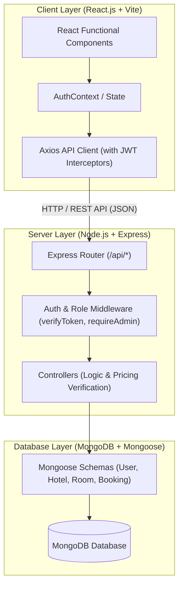

# StayEase — Full-Stack Hotel Booking & Management System

> **Academic Capstone Project**: B.Tech Computer Engineering — Web Technologies  
> **Brand Identity**: Elegant, Trustworthy, Calm, Minimal & Welcoming Editorial Hospitality Platform

---

## 1. Project Overview

**StayEase** is a commercial-grade, full-stack web application designed for boutique hotel reservations and administrative hospitality management. Inspired by modern hospitality software and contemporary editorial travel publications, the application combines rich aesthetics (warm ivory canvases, deep charcoal typography, muted forest green and bronze accents) with a robust engineering architecture.

The project demonstrates practical implementation of:
- **Frontend Architecture**: Component-driven UI using React 19, Vite, React Router v7, and Context API.
- **Backend Architecture**: RESTful API built on Node.js and Express.js with modular routes, controllers, and middleware.
- **Data Persistence & Modeling**: Relational-style document modeling via MongoDB and Mongoose schemas with validation and population.
- **Security & Authorization**: Stateless JWT authentication, bcrypt password hashing, role-based access control (`user` vs `admin`), and server-side pricing validation.
- **Concurrency & Availability**: Backend double-booking prevention ensuring room availability across overlapping calendar dates.

---

## 2. Architecture & Request-Response Flow

### High-Level Architecture Diagram



### Viva Explanation: Client-to-Database Request Lifecycle

$$\text{React Client} \xrightarrow{\text{HTTP Request}} \text{Express Route} \xrightarrow{\text{Middleware}} \text{Controller} \xrightarrow{\text{Mongoose Model}} \text{MongoDB} \xrightarrow{\text{JSON Response}} \text{React State Update}$$

1. **User Action**: A user triggers an action (e.g., booking a room or filtering hotels).
2. **Axios Client**: Formulates an asynchronous HTTP request with `Bearer <token>` in the Authorization header.
3. **Express Route**: Directs the incoming request to the targeted route definition.
4. **Middleware**: Validates JWT signature, checks role permissions (`admin` or `user`), and sanitizes inputs.
5. **Controller**: Executes business logic (e.g., independently calculates nightly rates and verifies that no overlapping active bookings exist).
6. **Mongoose Model**: Validates the schema against database constraints.
7. **MongoDB**: Stores or queries the document and returns the result.
8. **JSON Response**: Controller formats standard `{ success: true, message, data }` JSON response with appropriate HTTP status codes.
9. **React State Update**: Client updates local state/context and conditionally re-renders UI components.

---

## 3. Key Features

### Guest & Customer Features
- **Exploration & Discovery**: Search by destination city (Ahmedabad, Mumbai, Delhi, Jaipur, Goa), keyword, and stay dates.
- **Multi-Factor Filtering**: Live filtering by room type (*Standard, Deluxe, Suite, Family*), price range, minimum rating, and amenities (*Pool, Spa, Wi-Fi, etc.*).
- **Property & Room Inspection**: High-resolution image galleries, detailed descriptions, verified guest ratings, and verified amenities.
- **Safe 10-Step Booking Flow**:
  1. Select room $\to$ 2. Pick check-in $\to$ 3. Pick check-out $\to$ 4. Input guests $\to$ 5. Dynamic night calculation $\to$ 6. Transparent tax & rate breakdown $\to$ 7. Review booking summary $\to$ 8. Confirm reservation $\to$ 9. Server price & concurrency check $\to$ 10. Instant digital itinerary generation.
- **Booking Management**: View personal reservations, filter by status, and cancel eligible bookings with confirmation modals.
- **User Profile**: Access account details, contact information, and role indicators.

### Administrative Management Features
- **Executive Analytics Dashboard**:
  - Total registered guests, active hotels, room count, and total bookings.
  - Calculated **Realized Revenue** (strictly excluding cancelled reservations).
  - Recent reservations table with immediate status indicators.
- **Hotel Inventory CRUD**: Add, edit, inspect, and delete properties with full form validations.
- **Room Inventory CRUD**: Configure room types, numbers, maximum guest capacity, nightly rates, amenities, and availability status.
- **Reservation Roster**: View all platform reservations and update statuses (`pending`, `confirmed`, `completed`, `cancelled`).
- **User Directory**: View registered travelers and administrative staff with contact details.

---

## 4. Technology Stack

| Layer | Technology | Purpose |
| :--- | :--- | :--- |
| **Frontend** | React 19, JavaScript (ES6+) | Declarative user interfaces with Hooks |
| **Tooling** | Vite | Ultra-fast HMR and optimized production build |
| **Routing** | React Router DOM v7 | Client-side routing with nested layouts & route protection |
| **State Management** | React Context API | Global authentication, persistent login, and user roles |
| **HTTP Client** | Axios | Centralized API client with JWT request/response interceptors |
| **Icons** | Lucide React | Lightweight, consistent iconography |
| **Styling** | Custom CSS3 + Design System | Refined editorial hospitality styling, CSS variables |
| **Backend** | Node.js & Express.js | Modular, asynchronous RESTful API server |
| **Authentication** | JWT (JSON Web Tokens) & bcryptjs | Secure stateless tokens and salt-hashed passwords |
| **Database** | MongoDB & Mongoose | Document database with relational references and schemas |

---

## 5. Project Directory Structure

```text
stayease/
├── client/                               # React 19 Frontend
│   ├── public/
│   │   ├── favicon.svg
│   │   └── logo-icon.svg                 # Brand icon asset
│   ├── src/
│   │   ├── assets/                       # Static media assets
│   │   ├── components/                   # Reusable UI components
│   │   │   ├── AdminSidebar.jsx          # Admin navigation sidebar
│   │   │   ├── BookingCard.jsx           # Guest itinerary card
│   │   │   ├── BookingForm.jsx           # Date calculation & booking form
│   │   │   ├── EmptyState.jsx            # Fallback for empty results
│   │   │   ├── ErrorMessage.jsx          # Formatted error banner with retry
│   │   │   ├── FilterPanel.jsx           # Hotel search & filter sidebar
│   │   │   ├── Footer.jsx                # Editorial footer with attribution
│   │   │   ├── HotelCard.jsx             # Hotel catalog preview card
│   │   │   ├── Loader.jsx                # Smooth CSS spinner
│   │   │   ├── Modal.jsx                 # Accessible backdrop dialog
│   │   │   ├── Navbar.jsx                # Responsive navigation header
│   │   │   ├── ProtectedRoute.jsx        # Role-based route guard
│   │   │   ├── RoomCard.jsx              # Room unit card with capacity & rate
│   │   │   └── SearchBar.jsx             # Hero search bar
│   │   ├── context/
│   │   │   └── AuthContext.jsx           # Auth state & localStorage sync
│   │   ├── hooks/
│   │   │   └── useAuth.js                # Custom hook for auth context
│   │   ├── layouts/
│   │   │   ├── MainLayout.jsx            # Public & User layout (Nav + Footer)
│   │   │   └── AdminLayout.jsx           # Admin portal layout (Sidebar + Topbar)
│   │   ├── pages/
│   │   │   ├── admin/
│   │   │   │   ├── AdminBookings.jsx     # Reservation management
│   │   │   │   ├── AdminDashboard.jsx    # Analytics & metrics
│   │   │   │   ├── AdminHotels.jsx       # Hotel CRUD operations
│   │   │   │   ├── AdminRooms.jsx        # Room inventory CRUD
│   │   │   │   └── AdminUsers.jsx        # User directory
│   │   │   ├── Bookings.jsx              # Guest reservations
│   │   │   ├── BookRoom.jsx              # Booking workflow step
│   │   │   ├── BookingSuccess.jsx        # Confirmation receipt page
│   │   │   ├── Home.jsx                  # Hospitality homepage
│   │   │   ├── HotelDetails.jsx          # Gallery & room selector
│   │   │   ├── Hotels.jsx                # Hotel search & filter page
│   │   │   ├── Login.jsx                 # Login with CAPTCHA demo
│   │   │   ├── NotFound.jsx              # 404 handler
│   │   │   ├── Profile.jsx               # Guest profile
│   │   │   └── Register.jsx              # Registration with CAPTCHA demo
│   │   ├── services/
│   │   │   ├── api.js                    # Central Axios instance
│   │   │   ├── authService.js            # Auth API calls
│   │   │   ├── bookingService.js         # Booking & Admin stats API calls
│   │   │   └── hotelService.js           # Hotel & Room CRUD calls
│   │   ├── styles/
│   │   │   ├── variables.css             # CSS tokens & palette
│   │   │   ├── global.css                # Typography & base utilities
│   │   │   └── components.css            # Component-specific styles
│   │   ├── utils/
│   │   │   └── formatters.js             # INR currency & date math utilities
│   │   ├── App.jsx                       # Routing tree
│   │   └── main.jsx                      # DOM mount
│   ├── package.json
│   └── vite.config.js                    # Vite configuration & proxy
│
├── server/                               # Node.js + Express Backend
│   ├── config/
│   │   └── db.js                         # MongoDB Mongoose connection
│   ├── controllers/
│   │   ├── authController.js             # Register, login, getMe
│   │   ├── hotelController.js            # Hotel CRUD & filters
│   │   ├── roomController.js             # Room CRUD & capacity checks
│   │   └── bookingController.js          # Availability check & reservations
│   ├── middleware/
│   │   ├── authMiddleware.js             # JWT verification & admin guard
│   │   └── errorMiddleware.js            # Centralized error handler
│   ├── models/
│   │   ├── User.js                       # User schema
│   │   ├── Hotel.js                      # Hotel schema
│   │   ├── Room.js                       # Room schema
│   │   └── Booking.js                    # Booking schema
│   ├── routes/
│   │   ├── authRoutes.js                 # /api/auth routes
│   │   ├── hotelRoutes.js                # /api/hotels routes
│   │   ├── roomRoutes.js                 # /api/rooms routes
│   │   ├── bookingRoutes.js              # /api/bookings routes
│   │   └── adminRoutes.js                # /api/admin routes
│   ├── scripts/
│   │   └── seed.js                       # Database seed script
│   ├── server.js                         # Express application entry
│   └── package.json
│
├── postman/
│   └── StayEase.postman_collection.json  # Postman API test collection
├── .env.example                          # Environment variable template
├── .gitignore
├── README.md                             # Comprehensive project documentation
└── package.json                          # Root convenience runner scripts
```

---

## 6. Database Design & Schemas

### User Schema (`models/User.js`)
| Field | Type | Validation / Description |
| :--- | :--- | :--- |
| `name` | String | Required, trimmed |
| `email` | String | Required, unique, lowercase, trimmed, validated format |
| `password` | String | Required, hashed via bcryptjs (never returned in responses) |
| `phone` | String | Required, contact telephone number |
| `role` | String | Enum: `['user', 'admin']`, default: `'user'` |
| `createdAt` | Date | Timestamp automatically assigned |
| `updatedAt` | Date | Timestamp automatically updated |

### Hotel Schema (`models/Hotel.js`)
| Field | Type | Validation / Description |
| :--- | :--- | :--- |
| `name` | String | Required, property name (e.g., *Jai Mahal Heritage Palace*) |
| `description`| String | Detailed architectural and heritage overview |
| `location` | String | Area/neighborhood (e.g., *Civil Lines, Jaipur*) |
| `address` | String | Complete postal address |
| `city` | String | Required, indexed city name (e.g., *Jaipur*, *Mumbai*) |
| `images` | [String] | Array of high-resolution image URLs |
| `rating` | Number | Default: `4.5`, Range: `1.0` to `5.0` |
| `amenities` | [String] | Array of amenities (e.g., *Pool, Spa, Wi-Fi, Restaurant*) |
| `createdAt` | Date | Auto timestamp |
| `updatedAt` | Date | Auto timestamp |

### Room Schema (`models/Room.js`)
| Field | Type | Validation / Description |
| :--- | :--- | :--- |
| `hotelId` | ObjectId | Reference to `Hotel` document (`ref: 'Hotel'`), required |
| `roomNumber` | String | Required identifier (e.g., `'101'`, `'204'`) |
| `roomType` | String | Enum: `['Standard', 'Deluxe', 'Suite', 'Family']`, required |
| `description`| String | Room features, bed type, view description |
| `pricePerNight`| Number | Base price per night in INR ($\ge 0$) |
| `capacity` | Number | Maximum guest occupancy ($\ge 1$) |
| `amenities` | [String] | Array of room-specific amenities |
| `images` | [String] | Array of room interior photograph URLs |
| `isAvailable`| Boolean | Default: `true`, administrative availability toggle |

### Booking Schema (`models/Booking.js`)
| Field | Type | Validation / Description |
| :--- | :--- | :--- |
| `userId` | ObjectId | Reference to `User` document, required |
| `hotelId` | ObjectId | Reference to `Hotel` document, required |
| `roomId` | ObjectId | Reference to `Room` document, required |
| `checkIn` | Date | Required check-in calendar date |
| `checkOut` | Date | Required check-out calendar date (must be after `checkIn`) |
| `guests` | Number | Number of guests (must be $\le$ `room.capacity`) |
| `totalAmount`| Number | Total cost independently computed by server |
| `status` | String | Enum: `['pending', 'confirmed', 'cancelled', 'completed']` |
| `createdAt` | Date | Auto timestamp |
| `updatedAt` | Date | Auto timestamp |

---

## 7. Double-Booking Prevention & Date Concurrency

To ensure database integrity and avoid booking conflicts, the backend implements date-overlap verification before creating any reservation:

```javascript
// Overlap condition logic:
// Two bookings overlap if and only if:
// existing.checkIn < requested.checkOut AND existing.checkOut > requested.checkIn
const overlappingBooking = await Booking.findOne({
  roomId: requestedRoomId,
  status: { $in: ['pending', 'confirmed'] }, // Cancelled bookings release availability
  checkIn: { $lt: new Date(requestedCheckOut) },
  checkOut: { $gt: new Date(requestedCheckIn) }
});

if (overlappingBooking) {
  return res.status(409).json({
    success: false,
    message: 'This room is no longer available for the chosen dates.'
  });
}
```

> **Viva Note on Concurrency**: While simple application checks work well for educational and standard workloads, production-grade high-volume booking platforms handle concurrent requests using MongoDB Transactions (`session.startTransaction()`) or unique compound index constraints with advisory locking to avoid race conditions.

---

## 8. REST API Specification

All API endpoints return standardized JSON structures:

**Success Response**:
```json
{
  "success": true,
  "message": "Operation completed successfully",
  "data": { ... }
}
```

**Error Response**:
```json
{
  "success": false,
  "message": "Detailed and user-friendly error description"
}
```

### Endpoints Table

| Category | Method | Endpoint | Access Level | Description |
| :--- | :---: | :--- | :---: | :--- |
| **Auth** | `POST` | `/api/auth/register` | Public | Register new customer account |
| **Auth** | `POST` | `/api/auth/login` | Public | Authenticate user & return JWT token |
| **Auth** | `GET` | `/api/auth/me` | Authenticated | Retrieve current session profile |
| **Hotels** | `GET` | `/api/hotels` | Public | Query hotels (search, filter, paginate) |
| **Hotels** | `GET` | `/api/hotels/:id` | Public | Retrieve hotel details and room list |
| **Hotels** | `POST` | `/api/hotels` | Admin Only | Create new hotel record |
| **Hotels** | `PUT` | `/api/hotels/:id` | Admin Only | Update existing hotel |
| **Hotels** | `DELETE` | `/api/hotels/:id` | Admin Only | Delete hotel and associated rooms |
| **Rooms** | `GET` | `/api/rooms` | Public | Retrieve rooms by hotel ID or filters |
| **Rooms** | `GET` | `/api/rooms/:id` | Public | Retrieve single room details |
| **Rooms** | `POST` | `/api/rooms` | Admin Only | Add room to hotel inventory |
| **Rooms** | `PUT` | `/api/rooms/:id` | Admin Only | Update room details/pricing |
| **Rooms** | `DELETE` | `/api/rooms/:id` | Admin Only | Remove room from inventory |
| **Bookings**| `POST` | `/api/bookings` | Authenticated | Validate availability & create booking |
| **Bookings**| `GET` | `/api/bookings/my` | Authenticated | Retrieve personal booking history |
| **Bookings**| `GET` | `/api/bookings/:id` | Authenticated | Retrieve individual booking details |
| **Bookings**| `PATCH`| `/api/bookings/:id/cancel`| Authenticated | Cancel personal booking |
| **Admin** | `GET` | `/api/admin/bookings` | Admin Only | Retrieve all platform bookings |
| **Admin** | `PATCH`| `/api/admin/bookings/:id/status`| Admin Only | Modify booking status |
| **Admin** | `GET` | `/api/admin/users` | Admin Only | List registered platform accounts |
| **Admin** | `GET` | `/api/admin/stats` | Admin Only | Aggregate platform metrics & revenue |

---

## 9. Environment Variables

Create a `.env` file in the root directory (or in `server/`):

```ini
PORT=5000
MONGODB_URI=mongodb://localhost:27017/stayease
JWT_SECRET=stayease_super_secure_jwt_secret_key_2026
CLIENT_URL=http://localhost:5173
NODE_ENV=development
```

> **Security Note**: Never commit actual database passwords or secret keys to version control. The repository includes `.env.example` as a template.

---

## 10. Local Setup & Execution

### Prerequisites
- [Node.js](https://nodejs.org/) (v18.x, v20.x, or v22.x)
- [MongoDB Community Server](https://www.mongodb.com/try/download/community) running locally or a MongoDB Atlas URI

### 1. Clone & Install Dependencies
```bash
# Clone the repository
git clone https://github.com/your-username/stayease.git
cd stayease

# Install client dependencies
cd client
npm install

# Install server dependencies
cd ../server
npm install
cd ..
```

### 2. Run the Application
You can run the application directly from the root workspace:

```bash
# Option A: Start Frontend Dev Server from Root
npm run dev

# Option B: Start Frontend & Backend from their respective folders
# Terminal 1 (Frontend):
cd client
npm run dev

# Terminal 2 (Backend):
cd server
npm run dev
```

The frontend will run at `http://localhost:5173/` and the backend will run at `http://localhost:5000/`.

---

## 11. Database Seeding & Demo Credentials

To seed MongoDB with Indian destinations (*Ahmedabad, Mumbai, Delhi, Jaipur, Goa*), 5 hotels, 15 rooms, and demo accounts:

```bash
cd server
npm run seed
```

### Documented Demo Credentials

| Role | Email Address | Password | Permissions |
| :--- | :--- | :--- | :--- |
| **Admin** | `admin@stayease.com` | `admin123` | Full Administrative & Inventory Controls |
| **User** | `rohan@gmail.com` | `user123` | Guest Booking, Profile & Cancellations |
| **User** | `pooja@gmail.com` | `user123` | Guest Booking, Profile & Cancellations |

*(Both Login and Register pages include quick-fill buttons for immediate evaluation).*

---

## 12. Educational CAPTCHA Demonstration

In accordance with curriculum guidelines, an educational CAPTCHA demonstration checkbox is integrated into the registration and login forms with explicit labeling:

> *"CAPTCHA integration can help prevent automated abuse. (Demonstration only)"*

This demonstrates the concept of human verification in authentication workflows without relying on external third-party proprietary API keys during local college evaluations.

---

## 13. Production Build & Deployment

### Client Production Build
```bash
cd client
npm run build
```
Vite outputs the optimized, minified bundle into `client/dist/`.

### Deployment Instructions
- **Frontend (Vercel / Netlify)**:
  - Connect GitHub repository.
  - Set root directory to `client`.
  - Build command: `npm run build`.
  - Output directory: `dist`.
  - Environment variable: `VITE_API_URL=https://your-backend.onrender.com/api`.
- **Backend (Render / Railway)**:
  - Set root directory to `server`.
  - Build command: `npm install`.
  - Start command: `node server.js`.
  - Environment variables: `MONGODB_URI`, `JWT_SECRET`, `CLIENT_URL`.
- **Database (MongoDB Atlas)**:
  - Create free M0 cluster.
  - Configure Network Access to allow Render/Railway IP addresses.
  - Set connection string in backend `MONGODB_URI`.

---

## 14. Academic Syllabus Concepts Demonstrated

This project explicitly maps to university Computer Engineering curricula:

| Syllabus Concept | Practical Implementation in StayEase |
| :--- | :--- |
| **HTML5 Semantic Elements** | `<header>`, `<nav>`, `<main>`, `<article>`, `<section>`, `<aside>`, `<footer>`, `<figure>` |
| **CSS3 & Design Tokens** | CSS Custom Properties (`--bg-primary`, `--color-accent`), Flexbox, CSS Grid, media queries |
| **JavaScript (ES6+)** | `async/await`, Promises, arrow functions, destructuring, Array methods (`map`, `filter`, `reduce`) |
| **DOM & Virtual DOM** | React declarative rendering, synthetic event handlers (`onClick`, `onChange`, `onSubmit`) |
| **State Management** | React `useState`, `useEffect`, Context API (`AuthContext`) for cross-tree session state |
| **Client Routing** | `react-router-dom` v7 with nested layout outlets, URL query synchronization, and route guards |
| **Asynchronous Networking** | Axios instance with HTTP request/response interceptors for automatic JWT injection |
| **Session Persistence** | `localStorage` for JWT token and user snapshot recovery across page refreshes |
| **Backend Framework** | Node.js & Express.js with modular separation: Router $\to$ Middleware $\to$ Controller |
| **Authentication & Security** | JWT generation (`jwt.sign`) & verification (`jwt.verify`), bcrypt password hashing (10 salt rounds) |
| **Authorization (RBAC)** | `requireAdmin` middleware enforcing database-level role verification, preventing route tampering |
| **CORS Policy** | Express `cors` middleware configured with allowed origins (`CLIENT_URL`) |
| **Database Modeling** | Mongoose schemas with ObjectId references, cascade logic, indexing, and data validation |
| **Business Logic** | Date range arithmetic for night calculations, tax computation, and date-overlap checking |
| **Responsive Web Design** | Fluid layouts optimized across 375px mobile, 768px tablet, 1024px laptop, and 1440px desktop |
| **Error Handling** | Centralized Express error-handling middleware returning uniform error objects and HTTP codes |
| **SEO & Accessibility** | Semantic tags, descriptive page titles, meta descriptions, image alt tags, and focus rings |

---

## 15. License & Attribution

Developed for academic evaluation as a B.Tech Web Technologies Capstone.  
&copy; 2026 StayEase Hospitality Technologies. All rights reserved.
